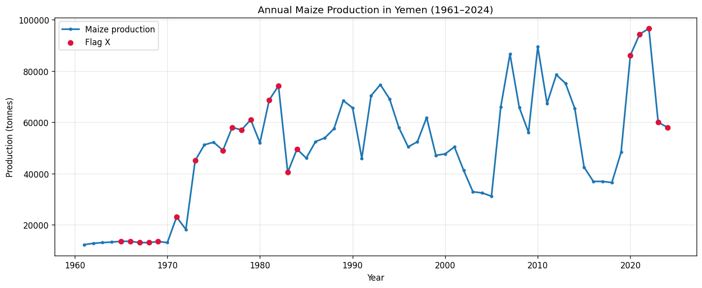
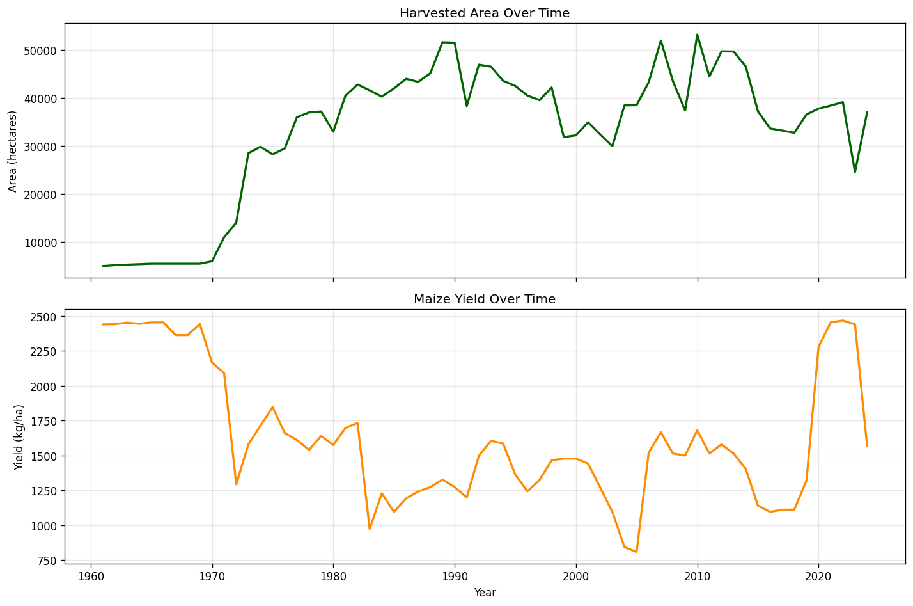
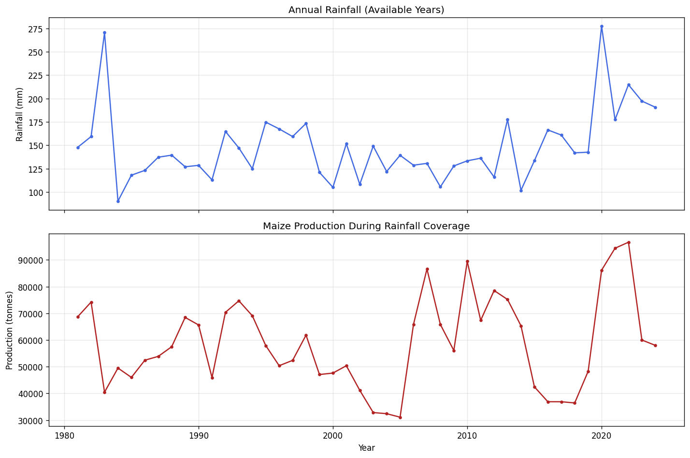
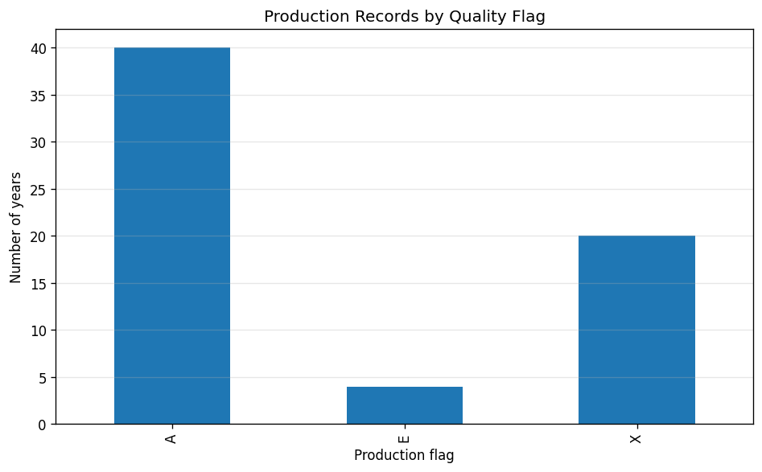
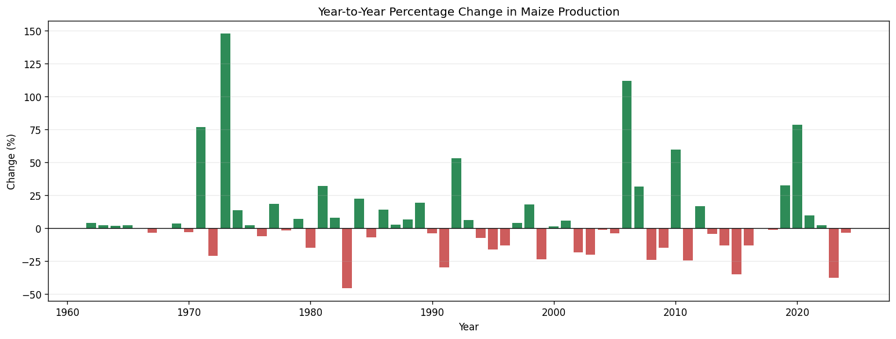
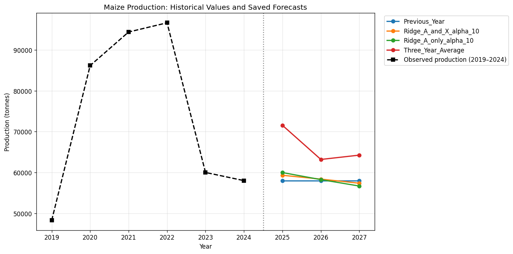

# 🌾 التنبؤ بإنتاج الذرة في اليمن (1961–2027)
### Yemen Maize Production Prediction & Forecasting Using Historical Data & Machine Learning

<p align="center">
  
  
  
  
  
</p>

---

## 📌 1. نبذة عن المشروع (Project Overview)

يهدف هذا المشروع البحثي والتطبيقي إلى دراسة وتحليل السلاسل الزمنية لإنتاج الذرة السنوي في الجمهورية اليمنية للفترة الممتدة من **1961 إلى 2024**، بالاعتماد على بيانات منظمة الأغذية والزراعة للأمم المتحدة (**FAOSTAT**) وبيانات هطول الأمطار السنوية. 

يتضمن المشروع هندسة ميزات زمنية ومناخية، وتقييم أداء عدة نماذج تنبؤية (مثل **Ridge Regression** وخطوط الأساس المرجعية)، مع إجراء تقييم زمني متدرج متعدد الآفاق (**Multi-Horizon Walk-Forward Evaluation**)، وتقديم تقديرات استشرافية لإنتاج الذرة للأعوام **2025–2027**.

---

## 📊 2. المعرض البصري والتحليلي (Visual Data Exploration & Analysis)

### 🔹 المحور الأول: المسار التاريخي والإنتاجية (1961–2024)

يوضح التحليل التاريخي مسار الإنتاج السنوي وتفاعله مع المساحة المزروعة ومعدلات الغلة (الإنتاجية لكل هكتار).

<table align="center" width="100%">
  <tr>
    <td align="center" width="50%">
      <br>
      <b>الشكل (1): التطور التاريخي لإنتاج الذرة السنوي في اليمن (بالطن)</b>
    </td>
    <td align="center" width="50%">
      <br>
      <b>الشكل (2): تطور المساحة المحصودة (هكتار) مقابل معدل الغلة (كجم/هكتار)</b>
    </td>
  </tr>
</table>

> **💡 ملاحظة تحليلية:** يُظهر الشكل (1) و(2) أن إنتاج الذرة شهد ذروته في سبعينيات وثمانينيات القرن الماضي تزامناً مع اتساع المساحات المزروعة، قبل أن يتجه نحو الاستقرار النسبي مع تذبذبات حادة ناتجة عن الظروف المناخية والاقتصادية.

---

### 🔹 المحور الثاني: المتغيرات المناخية وجودة البيانات

دراسة أثر معدلات الأمطار السنوية (1981–2024) بالإضافة إلى فحص موثوقية السجلات وفق تصنيفات الفاو (**FAOSTAT Quality Flags**).

<table align="center" width="100%">
  <tr>
    <td align="center" width="50%">
      <br>
      <b>الشكل (3): معدل هطول الأمطار السنوي وعلاقته بحجم الإنتاج</b>
    </td>
    <td align="center" width="50%">
      <br>
      <b>الشكل (4): توزيع تسجيلات البيانات بحسب أعلام الجودة (رسمية A مقابل غير رسمية X)</b>
    </td>
  </tr>
</table>

> **⚠️ تنبيه جودة البيانات:** يشير العلم `A` إلى بيانات رسمية معتمدة، بينما يشير العلم `X` إلى أرقام غير رسمية أو تقديرية، خصوصاً في العقد الأخير، مما يفرض ضرورة التفسير الحذر للقيم الحديثة واحتساب هامش عدم اليقين.

---

### 🔹 المحور الثالث: التقلبات السنوية والتنبؤ المستقبلي (2025–2027)

قياس وتيرة التغير السنوي (Volatility) ومقارنة نماذج تعلم الآلة لتقديم توقعات للفترة القادمة 2025–2027.

<table align="center" width="100%">
  <tr>
    <td align="center" width="50%">
      <br>
      <b>الشكل (5): نسب التغير والتقلبات السنوية في الإنتاج (%)</b>
    </td>
    <td align="center" width="50%">
      <br>
      <b>الشكل (6): مقارنة تنبؤات النماذج للفترة المستقبلية (2025–2027)</b>
    </td>
  </tr>
</table>

---

## 📈 3. نتائج التقييم ومقارنة النماذج (Model Performance)

### 1️⃣ نتائج الاختبار النهائي الزمني (Holdout Evaluation 2015–2019)
تم تدريب النماذج على البيانات حتى عام 2014 واختبارها على فترة حجب زمنية متتالية (2015–2019):

| النموذج (Model) | MAE (طن) | RMSE (طن) | $R^2$ | ملاحظات الأداء |
|:---|:---:|:---:|:---:|:---|
| **Ridge Regression ($\alpha=10$)** | 10,181.91 | **11,366.51** | -5.057 | حقق أقل خطأ تربيعي (RMSE) وأداءً أكثر استقراراً |
| **Previous Year Baseline** | **8,149.00** | 11,786.30 | -5.513 | حقق أقل متوسط خطأ مطلق (MAE) على الفترة القصيرة |

> **ملاحظة منهجية حول $R^2$ السالب:** القيمة السالبة تعني أن التباين في هذه العينة المقتطعة الصغيرة والمضطربة تاريخياً جعل التنبؤ عبر النماذج أصعب من الاعتماد على المتوسط العام، وهو أمر معتاد وموثق بشفافية في سلاسل الإنتاج الزراعي أثناء الأزمات.

---

### 2️⃣ التقييم الزمني التراكمي متعدد الآفاق (Walk-Forward 3-Year Horizon)

| الطريقة (Method) | الآفاق المقيمة | متوسط MAE عبر الآفاق | متوسط RMSE عبر الآفاق | الترتيب |
|:---|:---:|:---:|:---:|:---:|
| 🥇 **Ridge (Area + Yield)** | 3 سنوات | **14,935.4** | 18,842.5 | النموذج الأكثر اتزاناً متعدد المتغيرات |
| 🥈 **Ridge (Direct)** | 3 سنوات | 15,086.9 | **18,777.7** | أفضل RMSE إجمالي عبر الآفاق الثلاثة |
| 🥉 **Previous Year Baseline** | 3 سنوات | 15,861.0 | 20,637.8 | خط أساس بسيط لسنة واحدة |
| 4️⃣ **Three-Year Average** | 3 سنوات | 16,436.6 | 20,932.1 | خط أساس المتوسط المتحرك |
| 5️⃣ **Ridge (Log Change)** | 3 سنوات | 18,034.8 | 23,265.5 | نموذج التغير اللوغاريتمي |

---

## 🔮 4. التقديرات الاستشرافية لإنتاج الذرة (2025–2027)

*تنبيه: هذه القيم تمثل تقديرات ونمذجة إحصائية مبنية على المعطيات التاريخية وليست مشاهدات فعلية.*

| السنة | خط الأساس (السنة السابقة) | نموذج Ridge (بيانات A و X) | نموذج Ridge (البيانات الرسمية A فقط) | متوسط آخر 3 سنوات |
|:---:|:---:|:---:|:---:|:---:|
| **2025** | 58,000 طن | **59,306 طن** | 59,974 طن | 71,541 طن |
| **2026** | 58,000 طن | **58,368 طن** | 58,247 طن | 63,180 طن |
| **2027** | 58,000 طن | **57,367 طن** | 56,672 طن | 64,240 طن |

---

## 📁 5. هيكلية المستودع (Project Structure)

```bash
Yemen_Maize_Prediction_Final/
│
├── 01_Raw_Data/              # البيانات الأولية وسجلات FAOSTAT وبيانات الأمطار
│   ├── Yemen_Maize_FAOSTAT_Raw_1961_2024.csv
│   └── yemen_annual_rainfall_1981_2024.csv
│
├── 02_Processed_Data/        # البيانات المعالجة والميزات الزمنية المهندسة
│   ├── Stage2_Temporal_Features.csv
│   └── Yemen_Maize_Annual_Full_1961_2024.csv
│
├── 03_Train_Test_Splits/     # مجموعات التدريب والاختبار المنفصلة زمنياً
│   ├── train_through_2014.csv
│   └── test_2015_2019.csv
│
├── 05_Evaluation_Results/    # مقاييس التقييم، وجداول المقارنة ونتائج المراحل
├── 06_Forecasts/             # ملفات التوقعات للأعوام 2025-2027
│
├── 07_Figures/               # الرسوم والمخططات البيانية بدقة عالية
│   ├── 01_maize_production_history.png
│   ├── 02_area_and_yield.png
│   ├── 03_rainfall_and_production.png
│   ├── 04_production_flag_counts.png
│   ├── 05_annual_production_change.png
│   └── 06_forecasts_2025_2027.png
│
├── 08_Final_Report/          # التقرير العلمي النهائي المفصل (باللغة العربية)
│   └── Final_Report_AR.md
│
├── 09_Documentation/         # دفتر الملاحظات التفاعلي والتوثيق المرجعي
│   └── Yemen_Maize_Prediction_Final.ipynb
│
├── .gitignore                # قواعد تجاهل الملفات المؤقتة
└── README.md                 # بطاقة تعريف المشروع الرئيسية
```

---

## 🚀 6. متطلبات التشغيل وإعادة الإنتاج (Reproducibility)

لتشغيل المشروع محلياً واستعراض دفتر الملاحظات:

```bash
# 1. استنساخ المستودع
git clone https://github.com/AlHadaa/Yemen_Maize_Prediction_Final.git
cd Yemen_Maize_Prediction_Final

# 2. إنشاء بيئة عمل افتراضية (اختياري)
python -m venv venv
venv\Scripts\activate  # Windows
# source venv/bin/activate # Linux / Mac

# 3. تثبيت المكتبات الأساسية
pip install pandas numpy scikit-learn matplotlib seaborn jupyter

# 4. فتح دفتر العمل
jupyter notebook 09_Documentation/Yemen_Maize_Prediction_Final.ipynb
```

---

## 🌐 English Summary & Abstract

**Yemen Maize Production Prediction (1961–2027)**  
This project delivers a rigorous time-series and machine learning study on annual maize production in Yemen spanning over 6 decades (1961–2024). Utilizing data from **FAOSTAT** and historical rainfall indicators:
- **Temporal Feature Engineering**: Constructed lag features, rolling statistics, and yield-area interactions.
- **Evaluation Protocols**: Chronological holdout (2015–2019) and walk-forward validation across multiple horizons (1, 2, and 3 years).
- **Model Benchmark**: Evaluated Regularized Ridge Regression against standard naïve and moving-average baselines.
- **2025–2027 Projections**: Generated empirical forecasts under varying data-quality scenarios (accounting for FAO estimation flags `A` vs `X`).

---

<p align="center">
  <b>تم إعداد هذا العمل وتوثيقه بأعلى معايير الدقة والشفافية العلمية.</b><br>
  الباحث / المطور: <b>AlHadaa</b>
</p>
